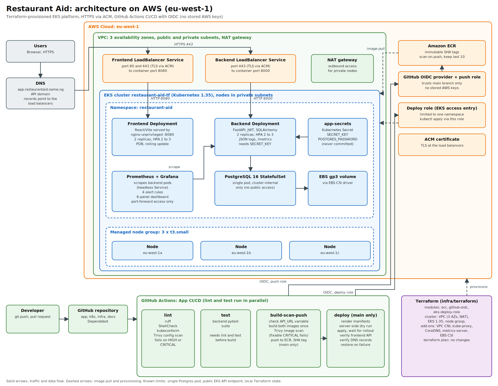

# Restaurant Aid: architecture and audit evidence

## Overview
Restaurant Aid is a restaurant ordering platform: customers browse a menu and place orders, and an admin manages items and order status. It runs on Amazon EKS (eu-west-1) on a cluster provisioned by Terraform, with images in Amazon ECR, delivered by a GitHub Actions pipeline. The site is served over HTTPS at https://app.restaurantaid.name.ng.

## Architecture
- **Frontend:** React/Vite built in a multi-stage Docker build and served by nginx-unprivileged on port 8080, 2 replicas.
- **Backend:** FastAPI with JWT auth and SQLAlchemy, 2 replicas. It refuses to start without a `SECRET_KEY` of at least 16 characters. It writes structured JSON logs and exposes Prometheus metrics at `/metrics`.
- **Container hardening:** Both workloads run as non-root with fixed UIDs, a read-only root filesystem, no privilege escalation, all capabilities dropped, the RuntimeDefault seccomp profile and an in-memory `/tmp`. Both Deployments also set a pod-level security context.
- **Database:** PostgreSQL 16 as a StatefulSet on an EBS gp3 volume (EBS CSI driver), reachable only inside the cluster.
- **Networking:** Two LoadBalancer Services expose the frontend and the API. TLS is terminated at the load balancers with an ACM certificate, and DNS records point the custom domain at them. CORS is restricted to the frontend origin, and the default is deny.
- **Monitoring:** Prometheus and Grafana run in the same namespace and are reached only through `kubectl port-forward`.
- **Secrets:** Kubernetes Secrets created by `scripts/bootstrap-secrets.sh`, never committed.

## How this meets the audit criteria

### 1. Infrastructure as Code
- Terraform modules in `infra/terraform`: `ecr` (immutable tags, scan on push, keep last 10), `github-oidc` (OIDC provider and push role), `eks-deploy-role` (deploy role limited to one namespace through an EKS access entry) and `certificate` (the ACM certificate used for HTTPS). These resources were first created by hand, then adopted into Terraform with `import` and `moved` blocks. `terraform plan` reports no changes.
- `infra/terraform/cluster` provisions the VPC (3 availability zones, NAT gateway) and the EKS cluster `restaurant-aid-tf` (Kubernetes 1.35, a managed node group of 3 x t3.small, and the VPC CNI, kube-proxy, CoreDNS, metrics-server and EBS CSI add-ons). The first apply created 66 resources, and this is the cluster that is live. `terraform plan` in this directory also reports no changes.
- Kubernetes manifests in `k8s/` cover the app, autoscaling, disruption budgets and monitoring, and the pipeline applies them. The Postgres StatefulSet and StorageClass are applied by hand, because changing a StatefulSet restarts the database.
- During development the app first ran on a cluster created with eksctl. I migrated to the Terraform-built cluster (database dump and restore, with row counts compared before cutover), then deleted the old cluster and confirmed no leftover resources.

### 2. Cloud resilience and HA
- Three nodes across eu-west-1a, 1b and 1c. Frontend and backend run 2 replicas each, with a zone topology spread (preferred, not enforced).
- Readiness and liveness probes on every workload, so failed pods are restarted and unready pods receive no traffic.
- Horizontal Pod Autoscalers (2 to 3 replicas at 70% CPU, using metrics-server), PodDisruptionBudgets (minAvailable 1), resource requests and limits, rolling updates with maxUnavailable 0, and a 10 second `preStop` delay.
- Applying a change to Postgres restarts its single pod. When I first did this, the API returned errors for roughly 10 to 15 seconds.

### 3. CI/CD automation
Every push runs four jobs:
- **lint:** ruff, ShellCheck, Kubernetes manifest validation (kubeconform) and a Trivy misconfiguration scan of `k8s/` that fails on HIGH or CRITICAL findings.
- **test:** the backend test suite.
- **build-scan-push:** checks the `API_URL` variable, builds both images once, scans them with Trivy (fixable CRITICAL findings fail the build), and pushes them to ECR tagged with the commit SHA, using GitHub OIDC with no stored AWS keys. The image that is scanned is the image that is deployed.
- **deploy (main only):** a namespace-scoped role renders the manifests with the new tag, runs a server-side dry run, applies them, waits for the rollouts, deploys monitoring, verifies that the running frontend points at this cluster's backend, and checks that the DNS records match the load balancers. If the rollout fails, a step restores the previous images.

A separate infra pipeline (`infra.yml`) runs `terraform fmt -check -recursive` on changes under `infra/`.

### 4. Observability and logging
- The backend logs one JSON line per request (method, path, status, duration, request ID).
- `/metrics` exposes request counts and latency histograms. Prometheus scrapes both backend pods through DNS service discovery on a headless Service.
- Four alert rules: backend down, instance down, high 5xx ratio and high p95 latency. A Grafana dashboard with six panels is provisioned from `observability/dashboard.json`.

## Key decisions and problems found by testing
1. **OIDC instead of AWS keys:** the pipeline roles trust only this repository's main branch, and the deploy role can only touch one Kubernetes namespace.
2. **Immutable SHA tags in ECR:** every deployment traces to a commit.
3. **Adopt, don't recreate:** existing AWS resources were imported into Terraform so the live app kept running.
4. **Dry run before apply:** a bad manifest or a missing permission fails before anything changes.
5. **Lean monitoring:** plain manifests sized for three small nodes, in place of a full monitoring stack. The account's free plan restricts instance types, so the nodes are t3.small.
6. **Metrics API unavailable:** the control plane could not reach metrics-server. I found it from the APIService status and fixed it in Terraform with a node security group rule.
7. **Frontend load balancer failing about half the time:** testing each load balancer address separately showed one address failing every request, with one node out of service. The node security group did not allow node-to-node traffic on port 80, so a node with no frontend pod could not reach the pods on other nodes. I fixed it with a rule in Terraform and verified that all nodes were in service and every address answered.
8. **Wrong API address after migration:** the frontend bakes in the API address at build time, and a repository variable still held the old one. I added two pipeline guards: one validates the variable, and one fails the deploy if the running frontend does not point at this cluster's backend.
9. **Hardening verified by scanning:** Trivy flagged Deployments that had a container-level security context but no pod-level one. Adding both cleared the findings, and the change went out through the normal pipeline with the rollout guards in place.

## Evidence
Screenshots and captured output are in `docs/evidence/`: the green pipeline run (including the Trivy manifest scan), `terraform plan` with no changes for both Terraform directories, nodes across zones, pods with autoscalers and budgets, the container security context, JSON logs and metrics, Prometheus targets and alerts, the Grafana dashboard, and the live HTTPS site.

## Limitations
- Postgres is a single pod on a single-zone disk; production would use RDS Multi-AZ.
- Postgres, Prometheus and Grafana still run with the default security context. Their Trivy findings are accepted in `.trivyignore.yaml` with an expiry date of 2026-12-31, because changing the Postgres StatefulSet restarts the database.
- The EKS API endpoint is public and open to 0.0.0.0/0, and node egress is unrestricted. The deploy job reaches the cluster from GitHub-hosted runners, so closing the endpoint would need private access and self-hosted runners.
- Terraform state is local; production would use an S3 backend with locking.
- Alerts are visible only in the Prometheus UI (no Alertmanager), and Prometheus keeps 24 hours of data on a temporary volume.
- `/metrics` is reachable through the public API load balancer; production would restrict it to in-cluster scraping.
- The frontend has no lint or test scripts, and the step that restores previous images has not been triggered by a real failure.
- Nodes do not autoscale.
